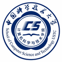
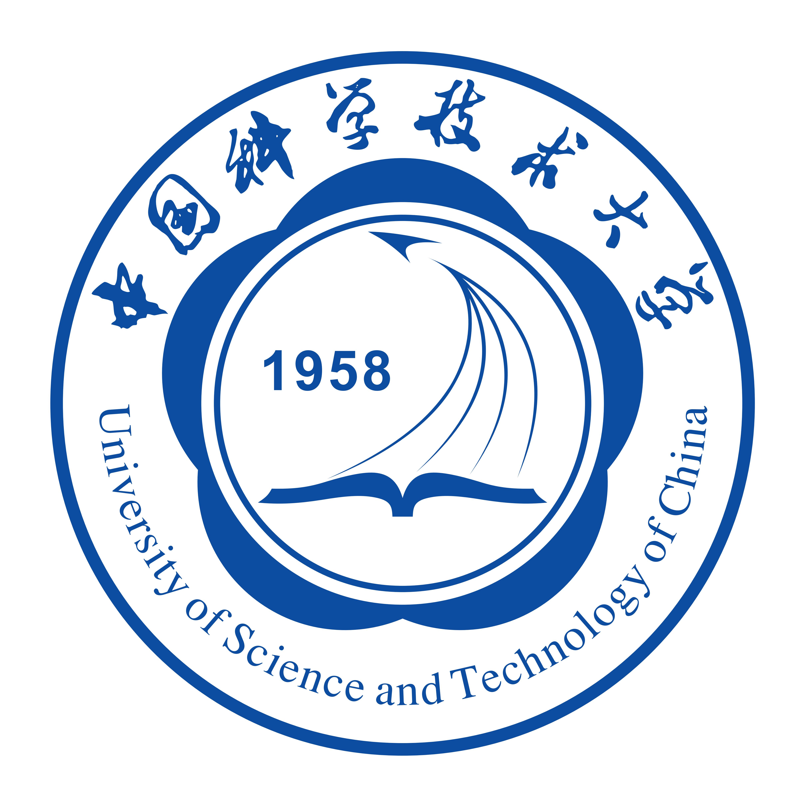
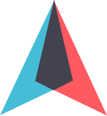
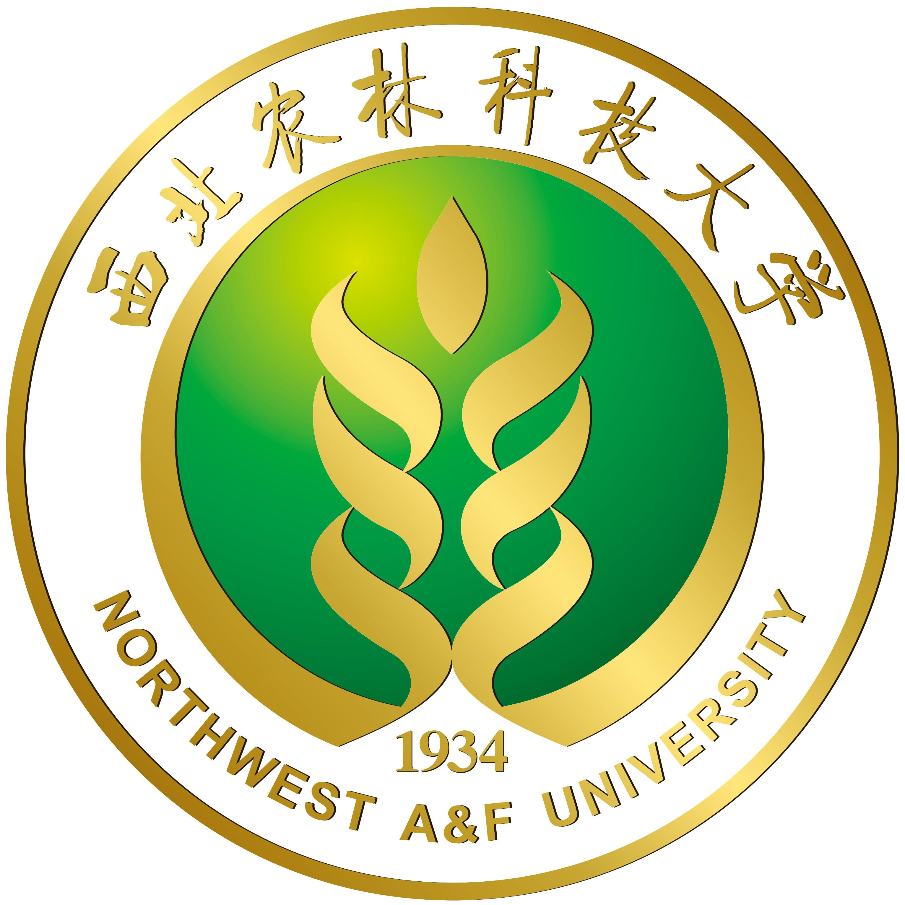
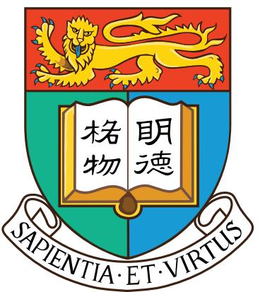
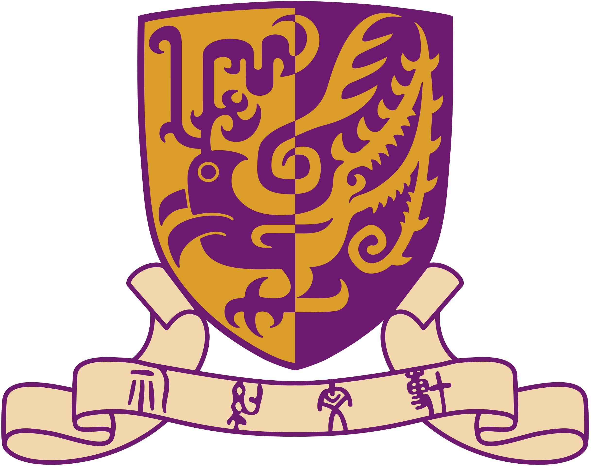

<!-- ==================== About Me Section ==================== -->
<section id="about">

<h2>👨🏻‍🎓 About Me</h2>

I recently received a master's degree from the <a href="https://cs.ustc.edu.cn">School of Computer Science and Technology</a> at the <a href="https://ustc.edu.cn/">University of Science and Technology of China (USTC)</a>.
I was a member of the <a href="https://acsa.ustc.edu.cn/">Advanced Computer Systems Architecture (ACSA) Laboratory</a>, which is led by <a href="https://cs.ustc.edu.cn/2020/0426/c23235a460072/page.htm">Professor Hong An</a>.
Before that, I obtained my bachelor's degree in Computer Science from the <a href="https://cie.nwsuaf.edu.cn/en/index.htm">College of Information Engineering (CIE)</a> at <a href="https://en.nwsuaf.edu.cn/">Northwest A&amp;F University</a> in 2023.
During my undergraduate studies, I joined the <a href="https://cie.nwsuaf.edu.cn/szdw/js/2014110093/index.htm">Parallel and Visual Processing Laboratory</a> led by <a href="https://cie.nwsuaf.edu.cn/szdw/js/2014110093/index.htm">Professor Bin Liu</a>.

 

<!-- As the <strong>first author</strong>, I have published in Journal of Computer Science and Technology (JCST), Performance Evaluation (PEVA), and IEEE/ACM Transactions on Computational Biology and Bioinformatics (TCBB).
Since 2026, I have served as a reviewer for IEEE Transactions on Parallel and Distributed Systems (TPDS). -->

My research interests lie at the intersection of <strong>high-performance computing</strong>, <strong>machine learning systems</strong>, and <strong>distributed training</strong>. Specifically, I focus on:

<ul style="margin-bottom: 1.5em;">
    <li style="margin-bottom: 12px; line-height: 2.0 !important;"><strong>Gradient Compression</strong> — Combining gradient sparsification with pipelined communication to reduce synchronization overhead in large-scale data-parallel training while preserving model accuracy.</li>
    <li style="margin-bottom: 12px; line-height: 2.0 !important;"><strong>Memory-Efficient Training</strong> — Designing runtimes that adapt GPU memory management to workload demands to lower peak memory use and sustain training throughput.</li>
    <li style="margin-bottom: 12px; line-height: 2.0 !important;"><strong>Efficient Multimodal Inference</strong> — Coordinating request scheduling, GPU memory management, and power control to meet latency targets and reduce energy use when serving mixed text and image generation requests.</li>
</ul>

 

<strong>I am currently seeking PhD opportunities for Spring/Fall 2027.</strong>

</section>

<!-- ==================== Education Section ==================== -->
<section id="education">

<h2>📖 Education</h2>

    <strong>University of Science and Technology of China</strong> (C9 League, 985 &amp; 211 University)
    2023–2026

<ul style="list-style-type: disc; margin-left: 20px; margin-top: 8px; margin-bottom: 20px;">
    <li style="margin-bottom: 12px; line-height: 2.2 !important;">Master's degree in Computer Science and Technology, <a href="https://cs.ustc.edu.cn">School of Computer Science and Technology</a></li>
    <li style="margin-bottom: 12px; line-height: 2.2 !important;">Lab: <a href="https://acsa.ustc.edu.cn/">Advanced Computer Systems Architecture (ACSA) Laboratory</a>, led by <a href="https://cs.ustc.edu.cn/2020/0426/c23235a460072/page.htm">Professor Hong An</a></li>
</ul>

    <strong>Northwest A&amp;F University</strong> (985 &amp; 211 University)
    2019–2023

<ul style="list-style-type: disc; margin-left: 20px; margin-top: 8px; margin-bottom: 20px;">
    <li style="margin-bottom: 12px; line-height: 2.2 !important;">Bachelor's degree in Computer Science and Technology, <a href="https://cie.nwsuaf.edu.cn/en/index.htm">College of Information Engineering</a></li>
    <li style="margin-bottom: 12px; line-height: 2.2 !important;">Lab: <a href="https://cie.nwsuaf.edu.cn/szdw/js/2014110093/index.htm">Parallel and Visual Processing Laboratory</a>, led by <a href="https://cie.nwsuaf.edu.cn/szdw/js/2014110093/index.htm">Professor Bin Liu</a></li>
</ul>

</section>

<!-- ==================== Publication Section ==================== -->
<section id="publication">

<h2>📝 Publications</h2>

<h3>📚 Published Papers</h3>



  


</section>

<!-- ==================== Project Section ==================== -->
<section id="project">

<h2>📽️ Research Projects</h2>

<h3>🚀 Ongoing Project</h3>
<ul>
    <li>
        <strong>Dataflow Programming and Runtime System Framework Adapted to Domestic Heterogeneous System Architectures</strong> 
        <em>Strategic Priority Research Program of Chinese Academy of Sciences</em> 
        Role: Project Member | Duration: 2023 - Present 
        Focus: Gradient compression algorithms for efficient distributed training on heterogeneous architectures
    </li>
</ul>

<h3>🎉 Completed Projects</h3>



  


</section>

<!-- ==================== Experience Section ==================== -->
<section id="internship">

<h2>⭐ Experience & Academic Service</h2>

<ul class="experience-list">
  <!-- <li class="experience-entry">
    Aug 2026 – Present
    

      <strong class="experience-role">Research Assistant</strong>
      
Foundation Models and Federated Learning research group, University of Technology Sydney

      
Supervised by <a href="https://profiles.uts.edu.au/Guodong.Long">Prof. Guodong Long</a>

    

  </li> -->
  <li class="experience-entry">
    2026 – Present
    

      <strong class="experience-role">Reviewer</strong>
      
IEEE Transactions on Parallel and Distributed Systems (TPDS)

    

  </li>
  <li class="experience-entry">
    Jul 2025 – Jan 2026
    

      <strong class="experience-role">Research Assistant</strong>
      
Systems and Networking Lab, The University of Hong Kong

      
Supervised by <a href="https://i.cs.hku.hk/~heming/">Prof. Heming Cui</a>, focusing on distributed training for unified multimodal large models.

    

  </li>
  <li class="experience-entry">
    Jul 2025
    

      <strong class="experience-role">Participant</strong>
      
Hong Kong PhD Fellowship Summer Workshop, The Chinese University of Hong Kong

    

  </li>
  <li class="experience-entry experience-entry--compact">
    Aug 2023
    

      
<strong class="experience-role">Participant</strong> &middot; <a href="https://dl.ccf.org.cn/albumList/getMeetingDetail6666263336028160">CCF HPC China 2023</a>

    

  </li>
  <li class="experience-entry experience-entry--compact">
    Fall 2022
    

      
<strong class="experience-role">Teaching Assistant</strong> &middot; Parallel Computing

      
Northwest A&amp;F University &middot; Assisted <a href="https://cie.nwsuaf.edu.cn/szdw/js/2014110093/index.htm">Prof. Bin Liu</a>

    

  </li>
  <li class="experience-entry experience-entry--compact">
    Summer 2022
    

      
<strong class="experience-role">AI Trainee</strong> &middot; Tedu Group

      
Developed a multi-object image annotation platform.

    

  </li>
  <li class="experience-entry experience-entry--compact">
    Summer 2021
    

      
<strong class="experience-role">Participant</strong> &middot; Baidu AI Talents Camp

      
Studied machine learning and PaddlePaddle.

    

  </li>
  <li class="experience-entry">
    2019 – 2020
    

      <strong class="experience-role">Staff Member</strong>
      
New Media Center, Northwest A&amp;F University

    

  </li>
</ul>

</section>

<!-- ==================== Award Section ==================== -->
<section id="award">

<h2>🏆 Awards</h2>

<h3>🔥 Scholarships</h3>
<ul style="margin-bottom: 1.5em;">
    <li style="margin-bottom: 12px; line-height: 2.0 !important;">National Scholarship</li>
    <li style="margin-bottom: 12px; line-height: 2.0 !important;">President Scholarship</li>
    <li style="margin-bottom: 12px; line-height: 2.0 !important;">Thanksgiving Scholarship for Modern and Contemporary Chinese Scientists</li>
    <li style="margin-bottom: 12px; line-height: 2.0 !important;">First-Class Professional Scholarship</li>
    <li style="margin-bottom: 12px; line-height: 2.0 !important;">First-Class Academic Scholarship</li>
</ul>

<h3>✨ Honors</h3>
<ul style="margin-bottom: 1.5em;">
    <li style="margin-bottom: 12px; line-height: 2.0 !important;">Outstanding Graduate</li>
    <li style="margin-bottom: 12px; line-height: 2.0 !important;">Excellent College Student</li>
    <li style="margin-bottom: 12px; line-height: 2.0 !important;">Advanced Individual in Social Practice</li>
    <li style="margin-bottom: 12px; line-height: 2.0 !important;">One of the 100 Campus Stars - Top Ten Scientific Research Stars </li>
</ul>

</section>

<!-- ==================== Competition Section ==================== -->
<section id="competition">

<h2>✅ Competitions</h2>

<ul class="competition-list">
  <li class="competition-entry">
    <strong class="competition-award">Third Prize</strong>
    

      11th Student RDMA Programming Competition
    

  </li>
  <li class="competition-entry">
    <strong class="competition-award">Meritorious Winner</strong>
    

      2022 Mathematical Contest in Modeling (MCM)
    

  </li>
  <li class="competition-entry">
    <strong class="competition-award">First Prize</strong>
    

      12th Blue Bridge Cup Competition
        Provincial Competition
    

  </li>
  <li class="competition-entry">
    <strong class="competition-award">Third Prize</strong>
    

      2021 Group Programming Ladder Tournament
        National
    

  </li>
  <li class="competition-entry">
    <strong class="competition-award">First Prize</strong>
    

      2022 The Competition of Computer Design
        Northwest Region
    

  </li>
  <li class="competition-entry">
    <strong class="competition-award">Second Prize</strong>
    

      12th National Mathematics Competition for College Students
    

  </li>
</ul>

</section>

<!-- ==================== Skill Section ==================== -->
<section id="skill">

<h2>⚙️ Technical Skills</h2>

<ul style="margin-bottom: 1.5em;">
    <li style="margin-bottom: 12px; line-height: 2.0 !important;"><strong>Parallel &amp; Distributed Computing:</strong> CUDA C, MPI, NCCL, OpenMP</li>
    <li style="margin-bottom: 12px; line-height: 2.0 !important;"><strong>ML Frameworks &amp; Libraries:</strong> PyTorch, DeepSpeed, TensorFlow, PaddlePaddle</li>
    <li style="margin-bottom: 12px; line-height: 2.0 !important;"><strong>Programming Languages:</strong> C/C++, Python</li>
</ul>

</section>
